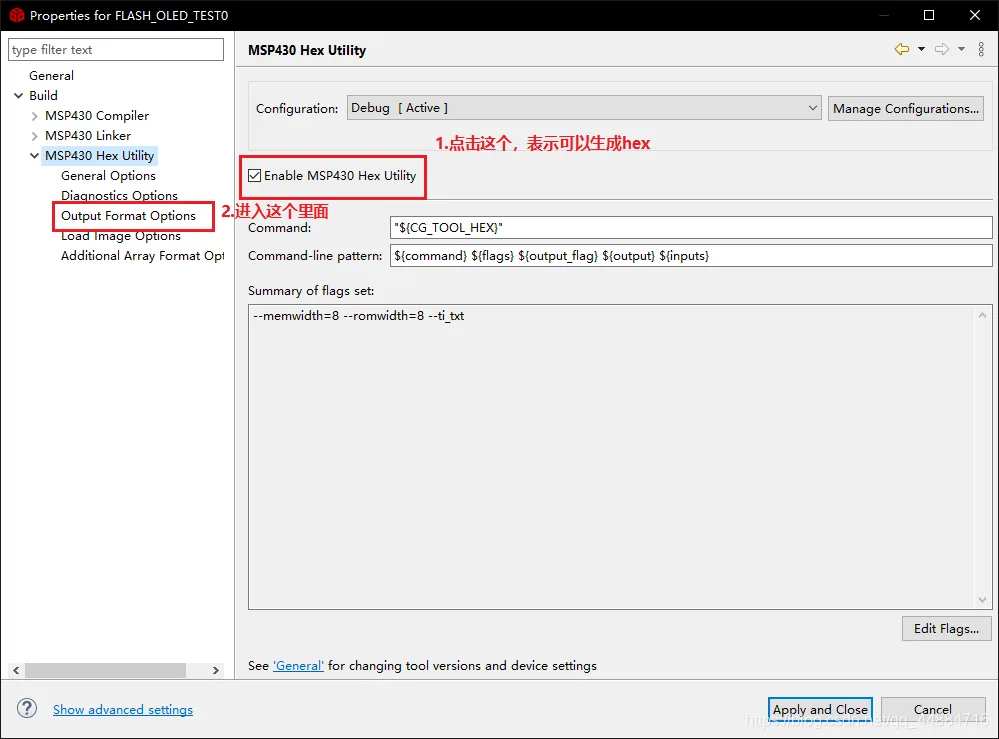
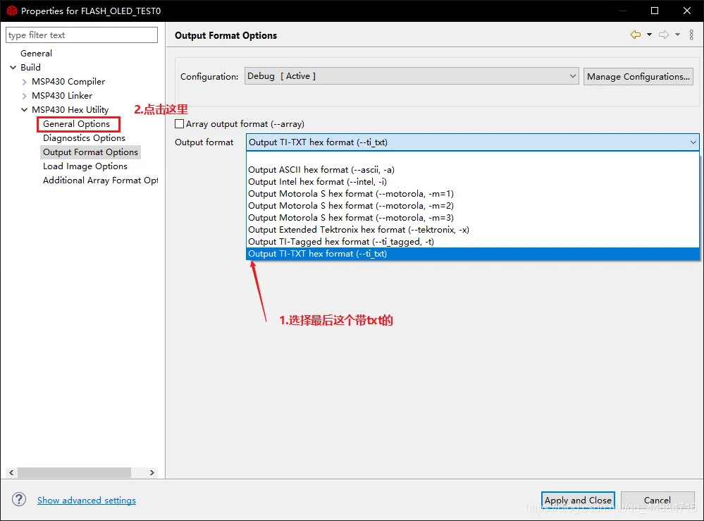
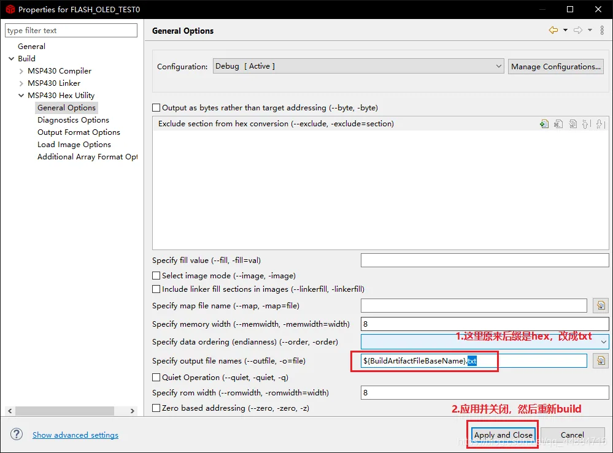
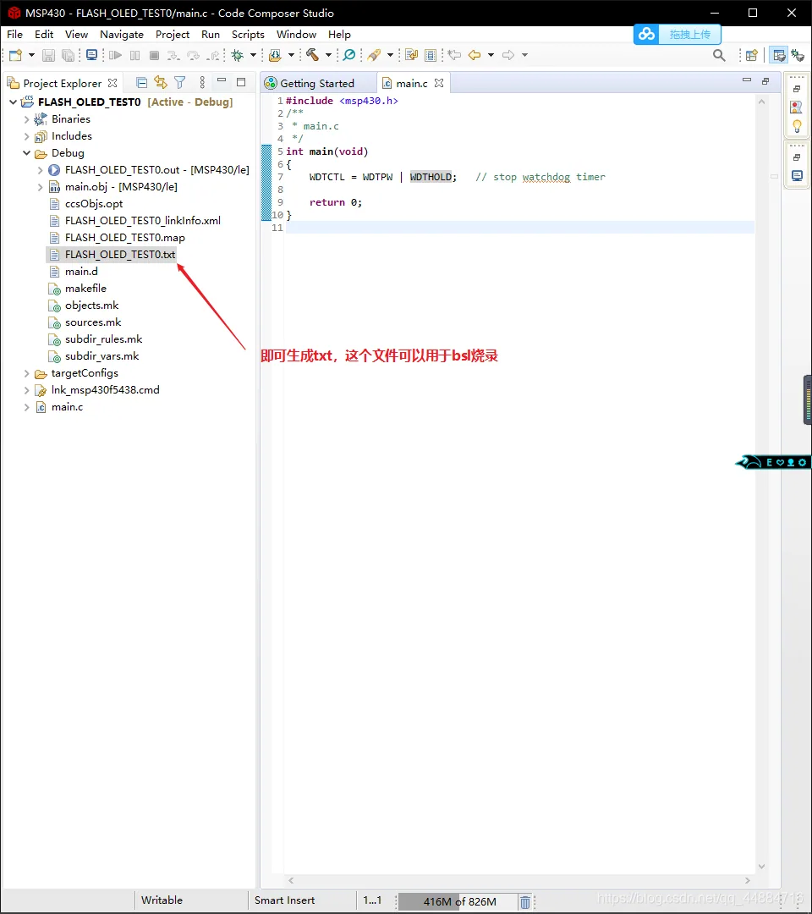

---
aliases:
  - "/posts/解决方案/使用ccs导出txt用于bsl烧录/"
image: "cover.jpg"
date: 2020-08-28T16:34:57+08:00
draft: false
title: '使用 CCS 导出 TXT 用于 BSL 烧录'
categories:
- 工具链
tags:
- CCS
- MSP430
- MSP432
- BSL
author: ["云雾海"]
description: "本文首发于CSDN，原文：https://blog.csdn.net/qq_44884716/article/details/108282347"
license: CC-BY-SA 4.0
---

# 使用 CCS 导出 TXT 用于 BSL 烧录

