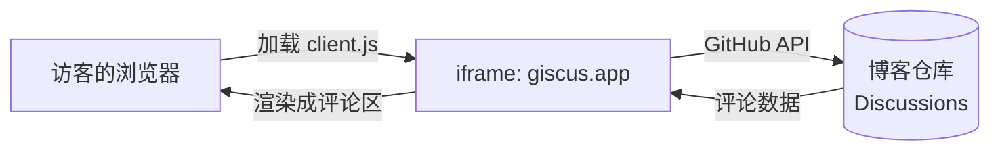

# 如何在Hugo中添加GitHub评论

## 前言

静态博客是没有后端的，评论功能天然缺失。能选的路线其实就这几条：

| 方案 | 评论存在哪 | 后端 | 说明 |
| --- | --- | --- | --- |
| giscus | 自己仓库的 GitHub Discussions | 不需要 | 免费、无广告、支持表情反应、明暗主题、懒加载 |
| utterances | 自己仓库的 GitHub Issues | 不需要 | 老牌方案，界面偏旧，没有 reactions |
| Waline / Twikoo | 自己的数据库 | 需要 | 功能最全，但要一台服务器或者 Serverless + 数据库长期维护 |
| Disqus | 第三方平台 | 不需要 | 免费版带广告和追踪，国内加载很慢 |

我最后选了 giscus。核心原因是**评论数据落在自己的仓库里**——文章和评论都在 GitHub，仓库在、数据就在，不会被某个厂商关停带走；而且访客用 GitHub 账号登录时，天然就过滤掉了绝大多数垃圾评论。

下面讲的是 giscus 通用的接入思路。代码我会尽量只给和主题无关的部分，遇到跟具体主题绑定的地方会单独标出来——毕竟每个人的主题都不一样，照抄别人的模板反而容易踩坑。

## giscus 是怎么工作的

giscus 本质上是一个托管在 `giscus.app` 上的前端页面，我们用 iframe 把它嵌进文章页，它再通过 GitHub API 把评论读写到自己仓库的 Discussions 里。



文章和 discussion 之间靠 `mapping` 参数建立对应关系，giscus 支持按 `pathname`、`url`、`title`、`og:title` 等字段匹配。我选的是 `pathname`，因为它只跟文章的 URL 路径有关，改标题、改描述都不会让评论失联。

## 第一步：开启 Discussions 并安装 giscus App

1. 进入博客仓库的 **Settings → General → Features**，勾上 **Discussions**。
2. 浏览器打开 [giscus.app](https://giscus.app)，在「仓库」一栏填入 `用户名/仓库名`，比如 `yunwuhai/yunwuhai.github.io`，然后点旁边的 **安装**，把 giscus 的 GitHub App 授权给这一个仓库（只授予一个仓库就够了，不必给全部仓库）。
3. 回到 giscus.app，选择 discussion 分类。分类只是给 discussion 打个标签，用哪个都不影响功能。我直接用了仓库里现成的 `Announcements`；如果你希望评论区看着更干净，也可以先在仓库的 Discussions 里新建一个 `Comments` 分类再回来选它。
4. 页面往下滚，会看到一个配置生成器，记下这四个值：

```text
repo        = yunwuhai/yunwuhai.github.io
repo-id     = R_kgDOP36lHQ
category    = Announcements
category-id = DIC_kwDOP36lHc4DJxCY
```

> 如果 giscus.app 上填完仓库提示 **"giscus is not installed on this repository"**，就是第 2 步的 App 没授权成功，回仓库的 Settings → GitHub Apps 里检查一下。

## 第二步：先搞清楚要传哪些参数

Hugo 本身不认识 giscus，也不存评论。giscus 的接入方式只有一种：**在页面里输出一个 client.js 脚本，用 `data-*` 属性把配置交给它**。所以不管什么主题、走哪种接法，最终要落的都是同一组参数：

| 参数 | 说明 |
| --- | --- |
| `data-repo` | 仓库全名，`owner/repo` |
| `data-repo-id` | 仓库 ID（`R_` 开头），不是仓库名 |
| `data-category` | discussion 分类名 |
| `data-category-id` | 分类 ID（`DIC_` 开头） |
| `data-mapping` | 文章和 discussion 的匹配键：`pathname` / `url` / `title` / `og:title` 等 |
| `data-strict` | `0`（默认）没匹配到就自动新建，`1` 只允许已存在的 |
| `data-reactions-enabled` | 是否允许表情回应，默认 `1` |
| `data-input-position` | 输入框放 `top` 还是 `bottom` |
| `data-theme` | 配色：`light` / `dark` / `transparent_dark` 等 |
| `data-lang` | 界面语言，不写默认英文 |
| `data-loading` | `lazy` = 滚进视口才加载 |

> `repo-id` 和 `category-id` 要用 ID 而不是名字：以后改了仓库名或分类名，ID 依然有效，名字就匹配不上了。

拿到参数之后，按你的主题分两条路走：

- **主题已内置评论支持**。不少主题的配置里有评论 provider 选项，选 giscus 再把上表的值填进去就行。但**键名每家都不一样**（有的叫 `repository`，有的叫 `repo`，有的嵌在 `params.comments.giscus` 下面），不要照抄别人的 `hugo.toml`，去主题文档查，或者直接在主题目录里搜：
  ```bash
  grep -ri giscus themes/<你的主题>/layouts
  ```
  搜到的那几个文件就是它读配置的地方，字段名一看便知。（Windows 上可以用 `rg` 或 PowerShell 的 `Select-String`。）
- **主题没有评论功能**。连配置都不用加，直接进第三步自己写模板。

我自己的站点用的是 Stack 主题，内置支持 giscus，配置写在 `hugo.toml` 的 `[params.comments.giscus]` 下——字段名和上表基本一一对应，但那是 Stack 的名字，换个主题就得重新找。

## 第三步：把评论区插到文章页模板

Hugo 的页面骨架分两层：`baseof.html` 是所有页面共用的外壳，`single.html` 才是文章页。评论区只应该出现在文章页，所以挂载点是**文章模板里正文结束之后**。

### 先找挂载点

在主题目录里搜输出正文的地方：

```bash
grep -rn "\.Content" themes/<你的主题>/layouts
```

找到渲染正文的那行，它下面的位置就是评论区该待的地方。有些主题把文章页拆成一堆 partial（正文在某个 `_partials/article/...` 里），那就从 `single.html` 顺着调用链找下去，落到文章页最外层那个 partial 的结尾。

### 用覆盖机制，不动主题源码

Hugo 查模板时**站点目录优先于主题**：把主题里的文件按相同相对路径复制到站点根目录的 `layouts/` 下，改这份副本即可。这样主题升级不会冲掉你的修改，也不用去改 submodule 里的源码。

### 主题没有评论功能：写一个 partial

新建 `layouts/_partials/comments/giscus.html`，里面就是 giscus 官方给的那段脚本（把值换成你自己的）：

```html
<script src="https://giscus.app/client.js"
        data-repo="yunwuhai/yunwuhai.github.io"
        data-repo-id="R_kgDOP36lHQ"
        data-category="Announcements"
        data-category-id="DIC_kwDOP36lHc4DJxCY"
        data-mapping="pathname"
        data-strict="0"
        data-reactions-enabled="1"
        data-input-position="top"
        data-theme="light"
        data-lang="zh-CN"
        data-loading="lazy"
        crossorigin="anonymous"
        async>
</script>
```

然后在文章模板（从主题复制到站点的那份 `layouts/_default/single.html`）里，正文后面加一行调用：

```html
{{ .Content }}

{{ partial "comments/giscus.html" . }}
```

两个容易踩的点：

- **别放到 `baseof.html`**。那是所有页面的外壳，列表页、首页、404 都会跟着渲染，一页里冒出好几个 iframe。
- **一页只放一次**。如果主题的评论区已经渲染过一次，就不要再加第二遍——多出来的 iframe 会抢同一个 discussion，还会重复加载脚本。

### 主题已经内置：什么都不用改

配置里启用就够了。比如 Stack 是：

```toml
[params.comments]
    enabled  = true
    provider = 'giscus'
```

文章模板会自动把评论 partial 调起来，我们只负责填参数。

我在这一步额外做的事只有一件：覆盖了一版 `layouts/_partials/comments/include.html`，在 iframe 外面包了个卡片容器、加了个「评论」小标题。这是纯样式层面的美化，不做也能正常评论。

## 第四步：中文界面

分两件事，别混在一起。

giscus **自己的界面**（"登录后可发表评论"这些话）由 `data-lang="zh-CN"` 控制，跟 Hugo 的 i18n 完全无关，填了就是中文。

容易出问题的是**你在模板里自己写的文案**。Hugo 的 i18n 是精确匹配语言键的：站点 `defaultContentLanguage = 'zh-cn'`，而主题只提供了 `i18n/zh.toml`，那么 `{{ T "commentsTitle" }}` 就拿到空字符串——标题位置一片空白。解决方式是把主题的语言文件按你的语言键复制一份、补上缺的词条：

```toml
# i18n/zh-cn.toml
commentsTitle = "评论"
```

（标题直接写死中文也行，只是以后要加英文站时还得再改一遍。）

## 第五步：让评论跟随明暗模式

这是整件事里唯一需要写逻辑的地方。

`data-theme` **只在初始化时读一次**，之后主题再怎么切，iframe 里的颜色都不会自己变。要换只能跟它通信，而且跨域 iframe 只能走 `postMessage`：

```js
iframe.contentWindow.postMessage({ giscus: { setConfig: { theme: "dark" } } }, "https://giscus.app");
```

giscus 那边监听了这条消息，收到就切。所以要做的事就两条：**iframe 出来以后先按当前状态对齐一次**，以及**之后每次站点切明暗再发一次**。

真正的麻烦不在发消息，而在「怎么知道现在是明暗、什么时候变了」——每个主题的切法都不一样：有的给 `<html>` 加 `class="dark"`，有的改 `data-theme` / `data-scheme`，有的只换 CSS 变量。通用的做法是盯 `<html>` 元素的属性变化，再配一个读背景色的兜底：

```html
<script>
    (function () {
        var light = "light", dark = "transparent_dark"; // 两套配色，按喜好换

        function isDark() {
            var el = document.documentElement;
            var s = (el.dataset.scheme || el.dataset.theme || el.getAttribute("data-color-scheme") || "").toLowerCase();
            if (s.indexOf("dark") >= 0) return true;
            if (s.indexOf("light") >= 0) return false;
            if (el.classList.contains("dark") || document.body.classList.contains("dark")) return true;
            var m = getComputedStyle(document.body).backgroundColor.match(/\d+/g); // 兜底：看背景亮度
            return m ? 0.299 * m[0] + 0.587 * m[1] + 0.114 * m[2] < 128 : false;
        }

        var applied = null;

        function send(force) {
            var frame = document.querySelector("iframe.giscus-frame");
            if (!frame || !frame.contentWindow) return false;
            var theme = isDark() ? dark : light;
            if (!force && theme === applied) return true;
            frame.contentWindow.postMessage({ giscus: { setConfig: { theme: theme } } }, "https://giscus.app");
            applied = theme;
            return true;
        }

        // 1) iframe 是异步加载的，等它出现
        var timer = setInterval(function () { if (send(true)) clearInterval(timer); }, 300);

        // 2) 站点切换明暗时（主题基本都会动这几个属性之一）
        new MutationObserver(function () { send(true); }).observe(document.documentElement, {
            attributes: true,
            attributeFilter: ["class", "style", "data-theme", "data-scheme", "data-color-scheme"]
        });
    })();
</script>
```

三段逻辑对应三个坑：

- `setInterval` 等 iframe：脚本执行时 giscus 可能还没加载出来，`querySelector` 会拿到 `null`。
- `MutationObserver` 盯 `<html>` 属性：这就是"任何主题都能用"的部分，不用知道它具体叫什么方案。
- `applied` 去重：同一次切换别重复发消息。

这段脚本放在渲染评论区的那份 partial 里（iframe 后面就行），有评论区的页面每次都会带上它。

如果发现某些主题在重渲染后颜色又弹回亮色，可以再补一个 `window` 的 `message` 监听，在 `e.origin === "https://giscus.app"` 时重发一次——注意加节流，别和 giscus 自己的消息形成循环。

**关于暗色配色**：giscus 预置的 `dark` 是深灰底，放进深色卡片里经常糊成一块不协调的方块。`transparent_dark` 背景透明，跟卡片底色融为一体，也是我最后选的。

## 第六步：样式微调（可选）

每个主题的 DOM 和 CSS 变量差别太大，写不出通用的样式表，但思路是固定的三条：

1. **给自己留个钩子**：在 partial 里给 iframe 外面套一层自己的容器（`<section class="comments">`），这样你至少有稳定的选择器可用。
2. **复用主题的卡片变量**：背景、圆角、内边距、阴影直接用主题已有的 CSS 变量，评论区就会自然长成和文章卡片一样的样子；主题没有这些变量就写死颜色。
3. **移动端单独收内边距**。

```scss
.comments {
    margin-top: 3rem;
    padding: var(--card-padding, 2rem);
    border-radius: var(--card-border-radius, 12px);
    background: var(--card-background, #fff);
    box-shadow: var(--shadow-l1, 0 1px 3px rgb(0 0 0 / 8%));
    overflow: hidden;
}

@media (max-width: 767px) {
    .comments { padding: 1.25rem 1rem; }
}
```

变量名对不上就换成主题自己的，实在没有就写死颜色——目的只有一个：让评论区看起来属于这张页面，而不是贴上去的第三方外挂。

## 常见问题排查

**评论区一片空白**
先看浏览器 Network 里 `client.js` 是不是 403。giscus 控制台报 `giscus is not installed on this repository`，说明 App 没授权到当前仓库；如果 Discussions 没开启，giscus 会直接报没有权限。

**只有一条灰色骨架，刷新几次都一样**
这是 `data-loading="lazy"` 的正常行为——评论区要滚进视口才开始加载 iframe，加载完还要再等一两秒。截图的时候尤其容易误判成"渲染坏了"。

**评论和文章对不上**
`mapping` 一旦改了，旧评论就全部失联（它们还挂在上一种映射的 key 上）。我用的是 `pathname`，所以文章 URL 尽量别动；真要改 URL，Hugo 的 `aliases` 只能把访问者重定向到新地址，**救不了**已经按旧路径建立的 discussion。

**怎么删评论、锁帖、置顶**
全都去仓库的 **Discussions** 页面操作，和普通的 GitHub 讨论一样。作者本人发评论会带上 `Author` 徽章。

**想临时关掉评论**
把启用开关改回 `false` 重新构建即可（Stack 是 `[params.comments] enabled = false`），模板不用动。

## 总结

giscus 大概是静态博客接评论性价比最高的方案：不用服务器、不用数据库、不用备案，评论数据留在自己的仓库里，访客用 GitHub 账号登录就能发言。要做的事归起来只有四件：装 App、开 Discussions、把参数交给页面、让文章模板输出那一个 iframe。

本文尽量只写和主题无关的部分：参数表是 giscus 自己的，找挂载点、覆盖模板的方法属于 Hugo 本身，明暗同步那段用的是通用的属性监听——换成 Blowfish、FixIt、PaperMod 或你自己手写的主题，思路一样能用，只是配置键名和文件路径要自己找一下。

本站文章底部的评论区就是这套配置（Stack 主题 + 内置 giscus + 一段明暗同步脚本），暗色模式下也是自动跟随的。如果只是想先跑起来，第二步和第三步就够用了；第四到第六步是把它做得"不像一个外挂"，可以按需加。
